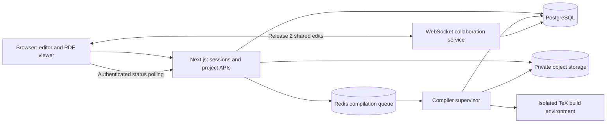

# Web LaTeX editor implementation plan

## Objective and assumptions

Build a Next.js application where users create LaTeX projects, edit multiple files in a browser, and see an automatically refreshed PDF alongside their source. Extend this foundation with collaborative editing, sharing, and history.

The repository now implements the editor and a SaaS foundation: Better Auth identity with verification/recovery/MFA, PostgreSQL persistence, tenant workspaces, workspace RBAC, project grants, ABAC checks, invitations, audit events, quotas, and a complete local Docker stack. Current sources and artifacts live in PostgreSQL; compilation uses synchronous requests to a private Docker supervisor. The broader queue, object storage, collaboration, and production acceptance architecture below remains the roadmap. See README.md for the implemented behavior and TASKS.md for current progress.

## Release scope

### Release 1: usable single-user editor

- Sign in and manage private projects: create, rename, duplicate, delete.
- Create a project from a blank document or a small set of built-in templates.
- Manage folders, `.tex`, `.bib`, and image files; choose the root document.
- Edit with highlighting, line numbers, indentation, bracket matching, search, and keyboard shortcuts.
- Autosave with visible saving, saved, disconnected, and conflict states.
- Compile manually or automatically after a typing pause; show status and actionable errors.
- View the actual compiled PDF with page navigation, zoom, search, and download.
- Preserve the last successful PDF when the current document has an error.
- Import and export project ZIP archives.

### Release 2: collaboration and recovery

- Invite project members with owner, editor, or viewer roles.
- Concurrent editing, presence indicators, and remote cursors.
- Recover from brief disconnections without silently losing accepted edits.
- Named snapshots, version history, and safe restore.
- Source-to-PDF and PDF-to-source navigation using SyncTeX.

### Later enhancements

Comments, tracked changes, advanced bibliography tools, Git integration, additional engines, organization workspaces, public templates, and billing. AI assistance is optional future scope.

## Proposed stack

| Area | Choice | Purpose |
| --- | --- | --- |
| Application | Next.js App Router, React, TypeScript | Pages, authenticated APIs, and application UI |
| UI | Tailwind CSS and accessible component primitives | Resizable workspace, dialogs, menus, and responsive layouts |
| Editor | CodeMirror 6 | Browser text editor with a validated LaTeX language extension |
| PDF | PDF.js | Render compiled PDFs with text/search and page controls |
| Database | PostgreSQL with Prisma | Users, projects, file revisions, memberships, builds, and history |
| Authentication | Maintained provider or library selected in setup | Sessions and account sign-in without custom password handling |
| Storage | Private S3-compatible object storage | Uploaded assets, immutable source snapshots, PDFs, and logs |
| Job queue | Redis and BullMQ | Compilation scheduling, deduplication, and bounded retries |
| Compiler | Pinned TeX Live image and latexmk | Repeatable builds with multiple passes and bibliography handling |
| Collaboration | Yjs, CodeMirror binding, authenticated WebSocket service | Shared text, awareness, and reconnection |
| Local infrastructure | Docker Compose | PostgreSQL, Redis, object storage, and worker dependencies |
| Verification | Vitest and Playwright | Service invariants and end-to-end editing workflows |

Use client components for CodeMirror, PDF.js, and browser interaction; use server components and server endpoints for authorized data access. Confirm LaTeX highlighting support in an early spike because editor support varies by extension.

## Architecture



Deploy the Next.js app, compiler service, and collaboration service independently. The compiler requires a container-capable host. A serverless web deployment can call the API and queue, but should not run TeX builds inside request handlers. Start with status polling; adopt push notifications only if measured demand warrants them.

Suggested layout:

```text
apps/web/                 Next.js pages, workspace UI, and API routes
services/compiler/       Queue consumer and sandbox supervisor
services/realtime/       Release 2 WebSocket service
packages/db/             Schema, migrations, and database access
packages/shared/         Validation, API types, and build contracts
infra/                   Compose, compiler image, and deployment configuration
docs/                    Decisions, operations, and developer setup
```

## Workspace experience

Use a project file tree on the left, source editor in the middle, and PDF preview on the right. Allow resizing and collapsing panels. Put project title, save state, compile controls, and downloads in a compact toolbar. Show compiler errors in a collapsible panel with file-and-line links when parsing is reliable, plus access to the original log.

On small screens, switch between files, source, and preview using tabs. Preserve editor selections, undo state, and PDF position when users switch files or compile again. Label previews with the revision they represent, especially while newer edits are waiting to compile.

## Persistence and API contracts

Core records:

- `User`: identity and account metadata.
- `Project`: owner, title, root file, engine, and monotonically increasing revision.
- `Membership`: project, user, and owner/editor/viewer role; introduced in release 2.
- `ProjectFile`: stable ID, project-relative path, kind, and current revision.
- `FileRevision`: immutable text or binary object reference and content hash.
- `Build`: project revision, source snapshot reference, engine/image version, state, duration, artifact references, and structured diagnostics.
- `Snapshot`: immutable project manifest and author; introduced in release 2.
- `CollaborationUpdate`: ordered persisted Yjs updates and compacted snapshots; introduced in release 2.

Represent each project revision as a consistent file manifest. Root selection, file mutations, and source edits advance the project revision atomically. Builds capture that manifest so later edits cannot alter an in-progress build. Stable file IDs keep identity through renames.

Initial endpoints: project CRUD; file/folder CRUD; revision-checked text save; bounded asset upload; build submission and status; authorized artifact access; ZIP import/export. Release 2 adds invitations, membership management, history, and short-lived collaboration credentials. Validate requests and authorize every operation against the project, including file IDs, build IDs, and downloads.

For release 1, save text after roughly 500–800 ms of inactivity and when changing files. A save includes the base file revision; reject a stale write with a conflict response rather than overwriting another tab's edits. Mark saved only after server acknowledgement. Keep a local recovery draft while a save is pending; clear it after acknowledgement and define cleanup on sign-out.

## Automatic compilation pipeline

1. An edit updates the browser immediately; autosave persists it with revision checks.
2. After approximately 1–1.5 seconds of inactivity, request compilation of the latest acknowledged project revision. Manual Compile flushes pending edits first. Unsaved or conflicted changes block compilation with a clear explanation.
3. Authorize and rate-limit the request, capture an immutable manifest, and create a build record. Deduplicate identical inputs using manifest hash, root file, engine, and compiler image version.
4. Queue the build. Permit one running job and one replaceable latest pending job per project. Continuous typing must not create an unbounded queue.
5. A supervisor stages only the snapshot's files into a fresh build environment, then executes latexmk with fixed, server-owned arguments. Start with pdfLaTeX and common bibliography tools.
6. Store the PDF, bounded log, and diagnostics. Publish terminal status, clean temporary files, and enforce artifact retention.
7. The browser loads the newest relevant successful artifact. An older completion must never replace a newer preview. Failed builds leave the last successful PDF visible with its revision label.

States: `queued`, `running`, `succeeded`, `failed`, `timed_out`, and `cancelled`. Recover abandoned jobs after worker crashes. Retry transient infrastructure failures a bounded number of times; syntax errors need an edit, not a retry. Cancellation must terminate the sandbox process tree.

Real-time preview is asynchronous compilation, so refresh latency includes debounce, queueing, compilation, and PDF loading. Proposed initial benchmark: a warm worker compiling a representative five-page document updates the preview within five seconds after submission at low load. Measure this before promising a product SLA.

## Compiler isolation and limits

Treat uploaded LaTeX and related files as untrusted executable input. This is a core implementation requirement for a hosted editor.

- Run each build as a non-root user with a read-only runtime, a dedicated writable temporary directory, and no network access.
- Disable shell escape explicitly; disable project-controlled latexmk RC files and executable hooks. Use fixed tool commands and an allowlisted engine.
- Restrict TeX file access; reject absolute paths, traversal, symlinks, and invalid archive entries before staging.
- Set CPU, memory, process, output, temporary disk, and wall-clock limits; begin with a configurable 30-second timeout and calibrate against sample documents.
- Expose no application credentials, host directories, or runtime control sockets inside the build environment.
- Separate the compiler host from the web/database trust boundary. Before public multi-tenant launch, validate a stronger sandbox runtime or equivalent isolation; ordinary container settings alone are not a complete security boundary.
- Cap project/upload sizes, archive expansion, build frequency, and log size; test the enforcement paths.

Start with a pinned, broad package set for compatibility. Explain unsupported packages and shell-escape-dependent features clearly. Update compiler images intentionally and identify the compiler version in every build.

## Collaboration design

Introduce Yjs shared text keyed by stable file IDs and bind it to CodeMirror. Keep file/folder operations under server-controlled transactions. Authenticate connections, authorize room joins and every mutating message, reject viewer writes, and disconnect revoked memberships. Presence is ephemeral and must not grant access.

The collaboration service becomes the authority for active text; avoid keeping a second independent HTTP autosave writer for collaborative documents. Persist updates before acknowledging durable save, compact them into snapshots, and materialize consistent project revisions for compilation. Capture text and file manifests at a defined revision boundary, including pending accepted updates across files.

Test reconnection, concurrent changes, server restart, duplicate messages, rename/delete during editing, membership revocation, and undo behavior. Restore history as a new project revision and coordinate a room reset/rebind so stale clients cannot silently reapply old changes over the restore.

## Delivery sequence and estimates

| Milestone | Deliverable | Rough effort for one experienced full-time developer |
| --- | --- | --- |
| M0 | Compiler/editor spikes, repository setup, infrastructure | 3–5 working days |
| M1 | Authentication, private projects, durable file editing | 5–8 days |
| M2 | Isolated compilation, autosave-triggered builds, PDF workspace | 7–12 days |
| M3 | ZIP transfer, templates, reliability, beta deployment | 5–8 days |
| M4 | Sharing, collaborative editing, durable reconnect | 8–15 days |
| M5 | History, SyncTeX, and operational hardening | 5–10 days |

These are planning estimates, not commitments. Release 1 is roughly 4–7 working weeks; release 2 adds roughly 3–5 weeks. Package compatibility, sandbox deployment, and durable collaboration are the largest uncertainties. Finish a vertical slice early: edit one document, save it, compile it, and display its PDF.

## Release gates

Release 1 is complete when a user can sign in, create a multi-file project with an image and bibliography, edit/save/reload it, receive an automatically updated PDF, fix a linked compiler error, and export/import the project. Verify stale-build handling, cross-project authorization, archive validation, timeout cleanup, and successful restore from a backup. Log request/build identifiers, queue latency, compilation duration, failures, and storage usage without recording private document contents.

Release 2 adds two-browser concurrent editing with convergence, durable recovery after a server restart, enforced viewer permissions and revocation, consistent shared builds, and safe history restore. Set retention and quotas before a public launch, and run a representative concurrent-build load test to size the worker pool.

## Official references

These support the proposed component choices; the product architecture and limits above are project recommendations.

- [Next.js server and client components](https://nextjs.org/docs/app/getting-started/server-and-client-components): browser interaction and server data boundaries.
- [CodeMirror reference](https://codemirror.net/docs/ref/): editor integration APIs.
- [PDF.js getting started](https://mozilla.github.io/pdf.js/getting_started/): browser PDF rendering.
- [latexmk on CTAN](https://www.ctan.org/pkg/latexmk/?lang=en): automated LaTeX build orchestration.
- [TeX Live guide](https://tug.org/texlive/doc/texlive-en/texlive-en.html): runtime setup and security considerations.
- [BullMQ deduplication](https://docs.bullmq.io/guide/jobs/deduplication): queue deduplication options; running-job coordination still needs application logic.
- [Yjs editor bindings](https://docs.yjs.dev/ecosystem/editor-bindings) and [WebSocket provider](https://docs.yjs.dev/ecosystem/connection-provider/y-websocket): shared editing integrations and transport.
