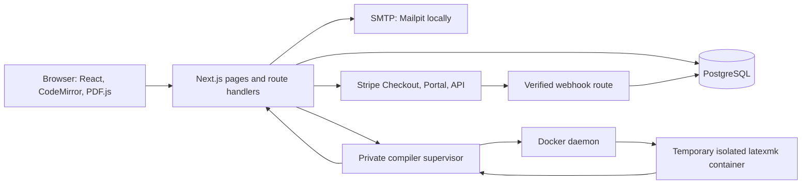

# System architecture

The browser handles interaction and short-lived editing/preview state. Protected server pages obtain identity from database-backed Better Auth sessions. Route handlers validate bodies and origins, then call domain services. Domain services resolve tenants, apply policy, serialize critical writes, and persist data.

Domain services under `src/server` own projects, workspaces, invitations, audits, usage, and build records. `src/server/billing/service.ts` owns checkout/provider reconciliation and verified payment-derived limits. Drizzle supplies typed models, queries, and transactions over the PostgreSQL driver; Better Auth uses its Drizzle adapter. `policy.ts` is a pure role-and-attribute evaluator shared by server decisions and returned UI permissions. `config.ts` centralizes core environment validation; the compiler also checks its own token.

The web runtime is Node.js because PostgreSQL, Stripe, mail, and server libraries require it. It does not run TeX in the request process. A private HTTP supervisor invokes Docker on a Docker-enabled host. The short-lived TeX job has no network and receives no application environment secrets.

Compose connects services using container DNS. Host development uses loopback addresses instead. Only the web, mailbox, SMTP, and host database ports are published locally. The compiler supervisor's Docker socket is a privileged host boundary even though the child job is constrained.

An optional `docs` Compose profile serves the Markdown documentation as a static VitePress build through Nginx on loopback port 4173. It has no application/database/compiler dependencies. See [documentation site](../getting-started/documentation-site.md).

There is no distributed queue or event bus. Webhooks and application operations use the same PostgreSQL tenant locking discipline. See [request flows](request-flows.md), [concurrency](concurrency.md), [database](../data/schema.md), and [compiler](../compiler/pipeline.md).

## Implementation references

- [compose.yaml](../../compose.yaml)
- [docs/architecture/source-structure.md](source-structure.md)
- [src/server/billing/service.ts](../../src/server/billing/service.ts)
- [services/compiler/server.ts](../../services/compiler/server.ts)
