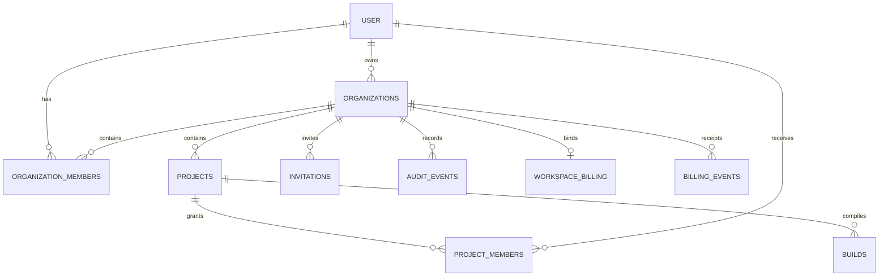

# Database ownership and relationships

Better Auth owns the identity/session/plugin tables created by its installed migration runner. Folio SQL migrations own tenant, project, build, audit, billing, and usage tables. Do not independently rename auth columns: their generated schema follows installed Better Auth options/version.

| Table                  | Key / purpose                                                                   | Important constraints                                                          |
| ---------------------- | ------------------------------------------------------------------------------- | ------------------------------------------------------------------------------ |
| `organizations`        | UUID tenant; name, owner, optional personal owner, status, plan, paid expiry    | Personal owner unique; owner references auth user; checked name/status/plan    |
| `organization_members` | Composite organization/user key; role, state, optional expiry                   | Organization/user cascade; checked role/state                                  |
| `projects`             | UUID; tenant/owner, JSONB source, positive revision, visibility/state           | Tenant cascade; owner FK; checked revision/visibility/state                    |
| `project_members`      | Composite project/user key; project role                                        | Project/user cascade; editor/viewer role                                       |
| `invitations`          | UUID; recipient, role, hash, state, expiries, creator                           | Token hash unique; tenant cascade; creator FK                                  |
| `builds`               | UUID; tenant/project/actor, revision, transient snapshot, status, PDF/log/times | Tenant/project cascade; actor set null on user deletion; PDF ≤16,000,000 bytes |
| `usage_counters`       | Text key, count, expiry                                                         | Key unique; atomic guarded increment                                           |
| `audit_events`         | UUID; tenant/actor/action/resource/JSON metadata/time                           | Tenant cascade; actor set null; no source body in save audits                  |
| `workspace_billing`    | Organization PK; unique customer/subscription bindings and checkout seed        | Tenant cascade; provider status/period/cancellation fields                     |
| `billing_events`       | Global event ID PK; tenant/type/processing time                                 | Tenant cascade; unique receipt supports deduplication                          |
| `schema_migrations`    | SQL filename PK + applied timestamp                                             | Created by migration script                                                    |

Indexes support membership-by-user, projects-by-tenant, invitations-by-tenant/state, builds-by-project/time, and audits-by-tenant/time. There is no PostgreSQL row-level-security policy in the migrations: application authorization is the tenant boundary. Direct database access bypasses it.

The full application DDL and all column defaults/checks are in [migration SQL](migration-sql.md). [Source model](../features/projects.md) explains JSONB fields; [authentication schema](auth-schema.md) distinguishes generated identity tables. Client response schemas are DTO contracts, not table definitions.

## Implementation references

- [migrations/001_saas.sql](../../migrations/001_saas.sql)
- [migrations/002_billing.sql](../../migrations/002_billing.sql)
- [migrations/003_billing_cancellation.sql](../../migrations/003_billing_cancellation.sql)
